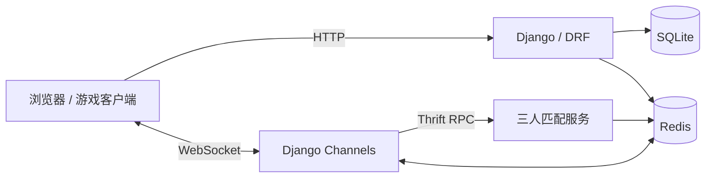

# acapp · 实时多人对战游戏

基于 **Django、Django Channels 和 JavaScript Canvas** 的网页对战游戏。项目包含单人机器人对战、三人实时匹配、火球与闪现技能、房间聊天，以及账号和积分管理。

前端负责游戏画面与交互，后端通过 HTTP 接口处理账号数据，通过 WebSocket 同步对战事件；独立的 Thrift 服务负责玩家匹配。可以通过这个项目了解网页游戏从用户登录、进入匹配队列到房间通信的实现过程。

[代码仓库](https://github.com/liujian-666/acapp) · [问题反馈](https://github.com/liujian-666/acapp/issues)

> **运行状态说明：** 仓库保留了原部署环境的部分配置和地址，尚未提供依赖锁定文件与通用配置模板。首次部署需要完成下文中的配置适配；以下说明依据当前代码整理，不代表已完成跨环境运行验证。

## 功能

| 模块 | 当前实现 |
| --- | --- |
| 账号系统 | 用户注册、账号密码登录、JWT 访问令牌与刷新令牌 |
| 单人模式 | 玩家与 5 个机器人进行对战 |
| 多人模式 | 三人匹配，通过 WebSocket 同步玩家创建、移动、攻击和闪现等事件 |
| 匹配服务 | 按玩家积分匹配，随着等待时间增加放宽积分差范围 |
| 游戏交互 | 鼠标移动、火球攻击、闪现、技能冷却和胜负提示 |
| 房间聊天 | 多人模式下发送与接收文字消息 |
| 积分与排名 | 对战积分更新；提供积分前 10 名的查询接口，排行榜展示页面仍待完善 |
| AcWing 接入 | 包含 Web 和 AcApp 授权登录流程，需要另行配置应用信息与回调地址 |

## 操作方式

进入游戏后，点击游戏画布使其获得焦点。

| 操作 | 效果 |
| --- | --- |
| 鼠标右键 | 向点击位置移动 |
| `Q`，再点击鼠标左键 | 向目标方向发射火球，冷却时间为 3 秒 |
| `F`，再点击鼠标左键 | 向目标位置闪现，冷却时间为 5 秒 |
| `Enter` | 多人模式下打开聊天输入框；输入内容后再次按下发送 |
| `Esc` | 关闭聊天输入框 |

多人对战需要匹配服务运行，并有三名玩家完成匹配。

## 技术栈与服务关系

| 层次 | 使用的技术 |
| --- | --- |
| 页面与游戏渲染 | HTML、CSS、JavaScript ES Modules、Canvas、jQuery |
| HTTP 接口 | Django、Django REST Framework |
| 身份认证 | Simple JWT、PyJWT、自定义 WebSocket 认证中间件 |
| 实时通信 | Django Channels、Redis Channel Layer |
| 匹配服务 | Python、Apache Thrift、线程与队列 |
| 数据存储 | SQLite、Django ORM |
| 房间与临时状态 | Redis、django-redis |
| 静态资源构建 | Terser、Django collectstatic |



## 项目结构

```text
acapp/
├── acapp/                       # Django 项目配置、HTTP 路由和 ASGI 入口
│   ├── asgi.py
│   ├── urls.py
│   └── settings.py              # 本地配置，不纳入版本控制
├── game/
│   ├── consumers/               # WebSocket 对战事件处理
│   ├── models/                  # 玩家信息与积分模型
│   ├── migrations/              # 数据库迁移
│   ├── views/                   # 注册、用户信息、排名与授权回调
│   ├── urls/                    # HTTP 接口路由
│   ├── templates/               # 游戏页面模板
│   ├── static/
│   │   ├── js/src/              # 游戏前端源码
│   │   └── js/dist/             # 合并压缩后的前端文件
│   ├── channelsmiddleware.py    # WebSocket JWT 认证
│   └── routing.py               # WebSocket 路由
├── match_system/
│   ├── thrift/match.thrift      # 匹配服务接口定义
│   └── src/                     # 匹配服务实现与生成的 RPC 代码
├── scripts/                     # 静态资源构建脚本、uWSGI 配置
├── static/                      # 收集后的静态资源
├── manage.py
└── .gitignore
```

修改前端时以 `game/static/js/src/` 为准。根目录的 `static/` 是静态资源收集目录，不作为前端源码的主要编辑位置。

## 本地开发

### 1. 获取项目与准备环境

```powershell
git clone https://github.com/liujian-666/acapp.git
cd acapp
python -m venv .venv
.\.venv\Scripts\Activate.ps1
```

以上使用 Windows PowerShell。Linux 或 WSL 下创建环境后，通过 `source .venv/bin/activate` 激活。

项目依赖 Python、Redis；重新构建前端资源时还需要 Node.js 和 Terser。现有 Bash 构建脚本适合在 Linux 或 WSL 中执行。

根据代码导入，主要 Python 依赖包括：

```text
Django
djangorestframework
djangorestframework-simplejwt
channels
channels-redis
django-redis
thrift
requests
PyJWT
daphne
```

**当前没有 `requirements.txt` 或依赖锁定文件。** 应优先从已验证的原运行环境整理依赖版本，再在独立虚拟环境中安装。上述清单用于定位依赖，不表示各包的任意最新版本都与当前代码兼容。

### 2. 准备本地配置

`acapp/settings.py` 和 `db.sqlite3` 已从版本控制中移除。已有本地配置的维护者可以继续使用；新克隆的环境需要自行创建 Django 配置文件。目前仓库尚未附带 `settings.example.py`。

配置时需要覆盖以下内容：

| 配置项 | 要求 |
| --- | --- |
| `SECRET_KEY` | 使用本环境独立生成的值，避免复用已公开的旧密钥 |
| `DEBUG` / `ALLOWED_HOSTS` | 本地调试允许 `localhost`、`127.0.0.1`；部署时填写实际域名 |
| `INSTALLED_APPS` | 包含 Django 基础应用、`game.apps.GameConfig`、DRF、Simple JWT 和所用 Channels 服务配置 |
| 中间件与模板 | 配置 Django 会话、认证、CSRF、消息等标准中间件，并开启应用模板发现 |
| 路由与应用入口 | `ROOT_URLCONF = "acapp.urls"`，`WSGI_APPLICATION = "acapp.wsgi.application"` |
| ASGI 入口 | `ASGI_APPLICATION = "acapp.asgi.application"`，注意名称不是 `SGI_APPLICATION` |
| `DATABASES` | SQLite 数据库路径设为项目根目录下的 `db.sqlite3` |
| `CACHES` | 使用 `django_redis.cache.RedisCache`；原配置连接 `redis://127.0.0.1:6379/1` |
| `CHANNEL_LAYERS` | 使用 `channels_redis.core.RedisChannelLayer`，连接实际 Redis 服务 |
| `REST_FRAMEWORK` | 配置 `rest_framework_simplejwt.authentication.JWTAuthentication` |
| `SIMPLE_JWT` | 设置令牌配置与新的 `SIGNING_KEY`；HTTP 签发与 WebSocket 验证应使用同一配置 |
| `ROOM_CAPACITY` | 当前匹配与游戏流程按三人设计，设置为 `3` |
| 静态资源 | 配置 `STATIC_URL` 与 `STATIC_ROOT`，保留 `django.contrib.staticfiles` |

仅创建 `.env` 文件不会自动加载变量，需要配置代码显式读取。不要把本地数据库、配置文件、虚拟环境或真实凭据提交到仓库。

### 3. 适配部署地址与第三方登录

当前前端包含原部署域名。启动本地服务之前，需要修改：

- `game/static/js/src/settings/zbase.js`：登录、注册、用户信息、令牌刷新和排名接口地址。
- `game/static/js/src/playground/socket/multiplayer/zbase.js`：WebSocket 连接地址。
- `game/views/settings/acwing/`：使用 AcWing 授权登录时的应用参数与回调地址。

同源部署时，HTTP 接口可以改为 `/settings/token/` 等相对路径。WebSocket 地址应与实际服务一致，例如本地 HTTP 环境使用：

```text
ws://127.0.0.1:8000/wss/multiplayer/?token=<access_token>
```

HTTPS 部署对应使用 `wss://`。修改前端源码后需要重新构建 `game.js`。

普通账号登录与 AcWing 授权登录是不同入口；暂不配置 AcWing 接入时，应禁用相应前端入口及路由。回调代码中的应用凭据也应改为读取本地配置，不能沿用原项目中的固定值。部分图片与前端库仍引用外部资源，部署时需要确认可访问性。

### 4. 初始化数据库

在配置和 Python 依赖准备完成后，于项目根目录执行：

```powershell
python manage.py check
python manage.py migrate
```

需要 Django 管理后台时，可以执行 `python manage.py createsuperuser`。管理后台账号不一定自动具备游戏所需的 `Player` 记录，游戏账号优先通过注册流程创建。

### 5. 启动服务

先启动 Redis，并确认配置中的连接地址可用。匹配服务默认监听 `127.0.0.1:9090`，Redis 原配置使用 `127.0.0.1:6379`。

在单独终端中激活同一 Python 环境，从项目根目录执行：

```powershell
cd match_system/src
python main.py
```

匹配脚本使用相对目录设置模块搜索路径，因此需要从 `match_system/src/` 运行。

另开终端，在项目根目录启动支持 ASGI 的开发服务器：

```powershell
python manage.py runserver 127.0.0.1:8000
```

使用 Channels 4 时，需要安装 Daphne，并将 `daphne` 放在 `INSTALLED_APPS` 中的 `django.contrib.staticfiles` 之前，让 `runserver` 支持 WebSocket。不同 Channels 版本的安装方式以对应版本文档为准：[Channels 安装说明](https://channels.readthedocs.io/en/stable/installation.html)。

配置完成后访问 `http://127.0.0.1:8000/`。仅启动 WSGI/uWSGI 服务不足以支持多人模式的 WebSocket 通信。

## 前端构建与部署

页面加载的是 `game/static/js/dist/game.js`。仓库已有构建产物；修改源码后，可以使用 `scripts/compress_game_js.sh` 重新生成。

执行脚本前先完成两项准备：安装 Terser，并将脚本中的 `JS_PATH` 改为当前项目的 `game/static/js/` 绝对路径。

```bash
npm install --global terser
# 在项目根目录执行；先修改脚本里的 JS_PATH
bash scripts/compress_game_js.sh
```

脚本会按文件路径排序、合并 JavaScript，经 Terser 压缩后写入 `dist/game.js`，随后调用 `collectstatic`。此脚本使用 Bash，Windows 可在 WSL 环境中运行，Python 依赖也需在该环境中准备好。

部署时应分别配置 HTTP、WebSocket 和静态资源服务，开启 HTTPS，并调整 `scripts/uwsgi.ini` 中的项目目录。开发服务器的静态资源服务方式不用于生产环境，参见 [Django 静态文件说明](https://docs.djangoproject.com/en/5.2/howto/static-files/)。

## 主要接口

| 类型 | 路径 | 用途 |
| --- | --- | --- |
| HTTP POST | `/settings/register/` | 注册游戏账号 |
| HTTP POST | `/settings/token/` | 获取 JWT 令牌 |
| HTTP POST | `/settings/token/refresh/` | 刷新访问令牌 |
| HTTP GET | `/settings/getinfo/` | 查询当前用户信息 |
| HTTP GET | `/settings/ranklist/` | 查询积分排名前 10 的玩家 |
| WebSocket | `/wss/multiplayer/` | 匹配接入、对战事件和聊天同步 |

需要认证的 HTTP 请求使用 `Authorization: Bearer <access_token>`；WebSocket 接入通过查询参数传递访问令牌。各接口的具体参数与权限行为以对应视图和中间件为准。

## 后续改进方向

- [ ] 提供不含凭据的配置模板与可复现的依赖清单。
- [ ] 将前端服务地址和第三方应用配置统一管理。
- [ ] 补充注册、认证、匹配、积分更新与 WebSocket 消息处理测试。
- [ ] 增强服务端消息校验、异常连接处理与对战状态校验。
- [ ] 完善排行榜页面、部署文档和游戏截图。
- [ ] 明确项目代码与素材的来源和许可证。

这些是待完成的改进方向。当前 `game/tests.py` 仍是初始测试占位文件，尚未提供完整的自动化测试覆盖。

## 反馈与贡献

欢迎通过 [Issues](https://github.com/liujian-666/acapp/issues) 反馈问题，尽量附上运行环境、复现步骤、预期结果和经过脱敏的错误日志。提交修改时，请说明解决的问题、涉及的模块和验证方式。

维护者：[liujian-666](https://github.com/liujian-666)。

## 许可证与素材

当前仓库根目录尚未提供项目级 `LICENSE`，本 README 不声明已采用某种开源许可证。第三方库、图片和其他素材的使用需遵循各自的许可；代码与素材的授权范围仍需进一步整理和说明。
